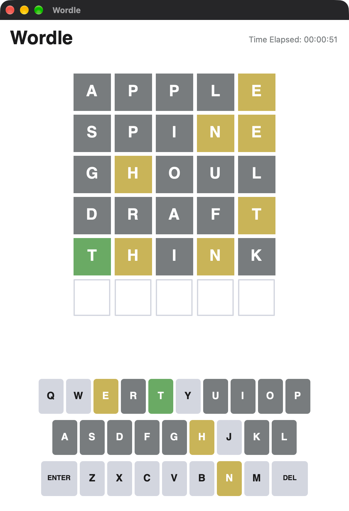

# Wordle 2.0

A C++ / wxWidgets Wordle clone. Version 2.0 is a cross-platform modernization of
the original college project:

- Builds and runs on macOS (wxWidgets 3.3.4), alongside Windows/Linux
- Authentic NYT-style Wordle UI (custom-drawn tiles + on-screen keyboard)
- Corrected duplicate-letter scoring
- Self-contained binary — dictionary and icon are embedded
- Clean, separated project layout and a Python build script

<p align="center">
  
</p>

## Binaries

- 2.0 — build from source (see below)
- Windows 1.1 (original): [Wordle v1.1](https://github.com/AC17dollars/cpp-wordle-clone/releases/tag/v1.1)

## Project layout

```
assets/           bundled data (compiled into the binary; not needed at runtime)
  dictionary/       word lists
  images/           icon
include/          headers
src/              portable sources (entry point, game logic, UI)
  platform/         OS-specific files (macOS dock icon, Windows resource)
scripts/          build scripts (incl. embed_assets.py)
```

Game logic (`src/gamemechanics.cpp`) is GUI-free; the UI (`src/Wordle.cpp`) and
platform glue (`src/platform/`) sit on top. `scripts/embed_assets.py` turns the
files in `assets/` into a C++ byte array (`build/generated/embedded_assets.cpp`)
that is compiled in, so the resulting binary is fully self-contained — it embeds
its dictionary and icon and needs no external files at runtime.

## Compilation

### Dependencies

+wxWidgets v3.0 or above

### Windows

Generate the embedded assets first, then compile it alongside the sources:

```
python scripts/embed_assets.py build/generated
g++ src/*.cpp build/generated/embedded_assets.cpp src/platform/icon.res -o build/release/Wordle.exe -I include -I build/generated -I path/to/wxWidgets/315/include -I path/to/wxWidgets/315/lib/gcc_dll/mswu -L path/to/wxWidgets/315/lib/gcc_dll -l wxmsw31u_core -l wxbase31u -mwindows
```

### macOS (wxWidgets 3.3.4)

`scripts/build.py` assumes wxWidgets 3.3.4 is already built next to this project
(in the parent directory) and links against it via a relative path to its
`wx-config` — nothing is installed on the system `PATH`. It produces two builds:

| Folder          | wxWidgets link | Needs the wxWidgets build in |
| --------------- | -------------- | ---------------------------- |
| `build/static`  | static — self-contained binary | `../wxWidgets-3.3.4/build-macos` (configured `--disable-shared`) |
| `build/dynamic` | dynamic — wx dylibs copied next to the binary | `../wxWidgets-3.3.4/build-macos-shared` (configured shared) |

Build wxWidgets once (either or both configs, depending on which build you want):

```
cd ..
git clone --depth 1 --branch v3.3.4 --recurse-submodules --shallow-submodules \
    https://github.com/wxWidgets/wxWidgets.git wxWidgets-3.3.4
cd wxWidgets-3.3.4

# static build (for build/static)
mkdir -p build-macos && cd build-macos
../configure --disable-shared --disable-debug --with-osx_cocoa && make -j$(sysctl -n hw.ncpu)
cd ..

# shared build (for build/dynamic)
mkdir -p build-macos-shared && cd build-macos-shared
../configure --disable-debug --with-osx_cocoa && make -j$(sysctl -n hw.ncpu)
```

Then build the game (the script embeds the assets automatically; whichever
wxWidgets build is missing is skipped):

```
python3 scripts/build.py
```

Both builds embed the dictionary and icon, so each is self-contained for its
assets. The `static` build is a single self-contained binary; the `dynamic`
build additionally relies on the wxWidgets dylibs, which are copied into
`build/dynamic/` beside the executable (via `@loader_path`). Run either from
anywhere:

```
./build/static/Wordle     # or: ./build/dynamic/Wordle
```
